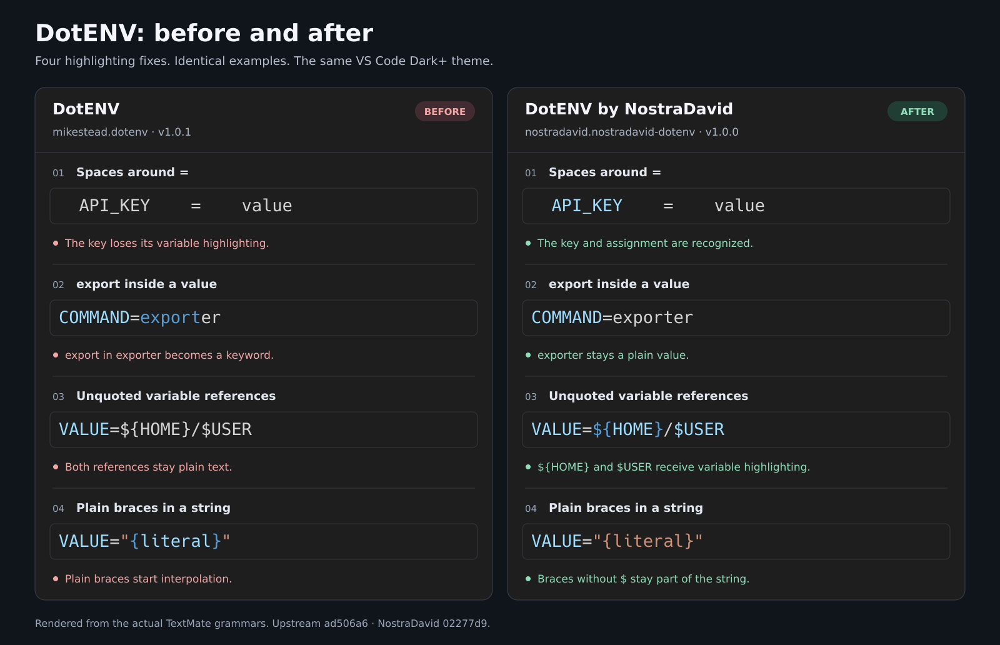

# DotENV by NostraDavid

Syntax highlighting for environment files, with tested quote, comment, assignment, and interpolation rules.

A maintained fork of [mikestead/vscode-dotenv](https://github.com/mikestead/vscode-dotenv). Original authorship and license notices are preserved. This fork starts at **1.0.0**.

## Highlighting fixes

Both columns use the actual grammars and the same VS Code Dark+ theme.

- Keys with extra spaces before `=` keep their variable highlighting.
- `export` inside a value such as `exporter` stays ordinary text.
- Unquoted `${HOME}` and `$USER` receive variable highlighting.
- `"{literal}"` stays a string because plain braces do not start interpolation.

The original grammar is from [`mikestead.dotenv` v1.0.1 at `ad506a6`](https://github.com/mikestead/vscode-dotenv/blob/ad506a66ede7d6215cb1f2a16c169eadd414916e/syntaxes/env.tmLanguage). The fixed grammar is from this fork's v1.0.0. Colors depend on your theme.

## Install

Download `nostradavid-dotenv-1.0.0.vsix` from [GitHub Releases](https://github.com/NostraDavid/dotenv/releases). In VS Code, open Extensions, choose **Install from VSIX**, and select that file.

Disable `mikestead.dotenv` before enabling this fork, since both register the `dotenv` language. Existing `[dotenv]` settings continue to work.

See [the beginner guide](docs/getting-started.md), [contribution guide](CONTRIBUTING.md), [changelog](CHANGELOG.md), and [release guide](docs/releasing.md).

## Supported syntax

Declarations start with a key and its first `=`. Keys may contain letters, digits, underscores, dots, and hyphens. Spaces and an optional leading `export` are accepted. Later equals signs belong to the value.

Single- and double-quoted values can span lines. Hashes inside quotes are literal; outside quotes they start comments. Apostrophes inside an unquoted value remain literal. `$NAME` and `${NAME}` receive variable highlighting outside single quotes. This describes highlighting, not a promise that every dotenv loader expands variables or accepts the same dialect. All environment values remain text at runtime.

VS Code 1.106 and later also include basic dotenv highlighting. This fork retains `source.env` scopes for existing theme customizations; the built-in grammar uses `source.dotenv`. Disable the old mikestead extension before using this fork. Use **Developer: Inspect Editor Tokens and Scopes** to check which grammar is active. Explicit `files.associations` remain the way to select the dotenv language for unconventional filenames. This extension never changes your language selection through startup code.

## Development

Install Nix, enter `nix develop`, then run `just setup` and `just check`. Run `just package` to build a VSIX. The flake supports x86_64/aarch64 Linux and macOS, including Intel macOS through the pinned Nixpkgs revision.

Dependency upgrades are explicit: `just lock-upgrade` and `just update-nix`. Normal setup uses the committed locks.
